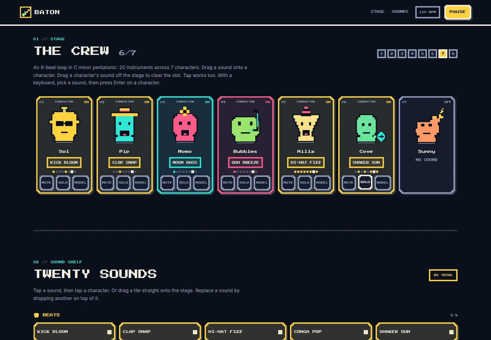

# Baton

A browser music-mixing game with an 8-bit console skin. Hand instruments from the
shelf to the seven characters and each one starts performing its own pattern on a
shared 8-beat loop at 110 BPM. Stack all seven and the track is yours.

Every one of the 20 instruments is synthesized at runtime with the Web Audio API —
there are no audio files and no backend of its own. The whole game is a single
static page.

> **Baton is meant to be orchestrated with models, not only by hand.** The end goal
> is a stage where a model can be handed an instrument and decide what to play with
> it, loop by loop, while the conductor places instruments and rates what comes
> back. The first model-backed tool has landed as a standalone CLI DJ in
> [`music-agent/`](music-agent/README.md): you ask for music in plain English and a
> local Ollama model searches, queues, and plays it. It is not wired to the browser
> game yet — there you still place every instrument yourself. See
> [Status](#status) for exactly what exists.



## Features

- **Seven characters, seven layers.** Each slot holds one instrument with its own
  pattern of eight velocities, so layers interlock instead of all firing on every
  beat.
- **Twenty procedural instruments** across four categories — Beats, Bass + Melody,
  Effects, Voices — all in C minor pentatonic, so any combination stays in key.
- **Real audio-clock timing.** A lookahead scheduler schedules notes at absolute
  `AudioContext` times. New layers enter on the next loop boundary; mute, solo,
  and removal apply immediately.
- **Handoff and takes.** Each slot card carries a `Model` toggle beside mute and
  solo. Handing a slot over marks its performer as a model and adds a `Take`
  button; one press sends one request for that instrument, and a usable reply
  becomes the slot's override on the next loop boundary. The slot card names the
  failure — unreachable server, unusable reply with a specific reason, or a
  request still in flight — and the pattern that is playing keeps playing.
  Taking the slot back restores the instrument's authored pattern. Each landed
  take waits for an `Accept`/`Reject` verdict; the card lists the whole take log
  oldest-first with every pattern and verdict, and the next request carries that
  log so the model can move toward what was approved. The log stays until the
  slot is handed back or the instrument is removed.
- **Mouse, touch, and keyboard.** Pointer-event drag and drop (no HTML5 drag
  API), tap-to-select, and a keyboard path: select an instrument tile, focus a
  character, press Enter to place it, or Delete/Backspace to clear it. Drag a
  character's instrument off the stage to remove it.
- **8-bit, modern.** Dark eight-colour palette, Press Start 2P display type,
  Inter body copy, hard 4 px frames, stepped corners, and offset shadows with no
  gradients or blur. All characters, icons, and the logo are inline SVG pixel art.
- **Responsive.** Verified at 375 px, 768 px, and 1440 px. The stage is a
  two-column grid on phones, four columns on tablets, and seven columns on
  desktop. The shelf sits below it.
- **Explicit state.** Mute and solo expose `aria-pressed`; the beat indicator and
  each layer's pattern dots are driven by the audio clock. Motion is stepped and
  disabled under `prefers-reduced-motion`.
- **First model-backed tool.** `music-agent/` is a working command-line DJ: a small
  local Ollama model calls eight tools — `search_music`, `play`, `queue_add`,
  `pause`, `resume`, `skip`, `set_volume`, `now_playing` — over yt-dlp search
  and mpv playback. No cloud API, no API key, no audio written to disk.

## Getting started

Requires Node 18+ and npm.

```sh
cd frontend
npm install
npm run dev      # http://localhost:5173
```

Production build:

```sh
npm run build    # outputs to ../dist
npm run preview
```

Tests run on Node 22's built-in runner — nothing extra to install:

```sh
npm test         # node --test; discovers src/*.test.js
```

No environment variables, API keys, or backend services are needed to play the
browser game by hand. Model takes are optional and need only the local model
server described below.

### CLI DJ

The DJ lives in `music-agent/` and is independent of the browser game. It
needs Python 3.10+, a running [Ollama](https://ollama.com) server with a small
tool-calling model, and [mpv](https://mpv.io) on `PATH`:

From the repository root:

```sh
sudo apt install mpv                 # macOS: brew install mpv, Windows: winget install mpv
ollama serve                         # in another terminal
ollama pull qwen2.5:3b

python -m venv .venv                 # skip if .venv already exists
source .venv/bin/activate            # Windows: .venv\Scripts\activate
pip install -r music-agent/requirements.txt
cd music-agent
python agent.py
```

Then type requests such as `play something chill for coding`, `skip this`,
`queue some Beatles`, `turn it down to 30`, or `what's playing?`. The DJ reads
`OLLAMA_MODEL` and `OLLAMA_HOST` from the environment, defaulting to
`qwen2.5:3b` and `http://127.0.0.1:11434`; `llama3.2:3b` and `qwen3:4b` work by
changing only `OLLAMA_MODEL`. Put overrides in a repo-root `.env` (copy
`.env.example`); `.env` and `.env.*` are gitignored, so real keys and local
settings never enter the repository. Full details, including troubleshooting,
are in [`music-agent/README.md`](music-agent/README.md).

### Browser model performers

The browser calls your local model server directly over HTTP; there is no
service in between and no settings screen. The server address and the model
name are two constants at the top of `frontend/src/model-play.js`:

```js
export const MODEL_SERVER = "http://127.0.0.1:11434";
export const MODEL_NAME = "qwen2.5:3b";
```

Change those two lines to swap models. The default is the same Ollama server
and model as the CLI DJ; pull it with `ollama pull qwen2.5:3b` and keep
`ollama serve` running. Nothing is persisted and no take is sent anywhere else.

The one machine setting that can get in the way is the server's origin
allow-list. Serve the game on `http://localhost:5173` (the Vite dev server). If
the browser reports the model as unreachable, start the server with that origin
allowed:

```sh
OLLAMA_ORIGINS=http://localhost:5173 ollama serve
```

The browser game still needs no environment variables, API keys, or backend of
its own; takes only work while a local model server is running.

The contract with the model is one JSON object containing a `pattern` array of
exactly eight numbers in 0–1:

```json
{"pattern": [1, 0, 0, 0.5, 0, 0, 0.5, 0]}
```

Anything else is rejected without changing the playing pattern, and the slot
card says which check failed (not JSON, no pattern array, wrong length,
non-numeric, out of range).

Each request also carries the slot's take log, oldest take first, with every
eight-velocity pattern and its verdict, so an accepted take becomes the
direction of the next proposal and a rejected one becomes what to avoid. With
no takes yet, the prompt says the proposal is the first.

## How to play

| Action | Mouse | Touch | Keyboard |
| --- | --- | --- | --- |
| Start audio | Click **START THE MIX** | Tap **START THE MIX** | Focus the button, press Enter |
| Place an instrument | Drag a tile onto a character, or click a tile then a character | Drag a tile onto a character, or tap a tile then a character | Focus a tile, press Enter, focus a character, press Enter |
| Replace an instrument | Drop another instrument on an occupied character | Same | Select another instrument, then press Enter on the character |
| Move an instrument | Drag it from one character to another | Same | — |
| Remove an instrument | Drag it off the stage | Same | Focus the character, press Delete or Backspace |
| Mute / solo a layer | Toggle **Mute** / **Solo** on the card | Same | Tab to the toggle, press Space or Enter |
| Hand a slot to the model | Toggle **Model** on the card | Same | Tab to the toggle, press Space or Enter |
| Ask the model for a take | Press **Take** on a model-played card | Same | Tab to the button, press Space or Enter |
| Rate a landed take | Press **Accept** or **Reject** on the card | Same | Tab to the button, press Space or Enter |
| Pause the music | **PAUSE** in the header | Same | Same |

A landed take must be accepted or rejected before **Take** can be pressed again.
Rejecting a take does not undo the pattern already playing; it records the
verdict and tells the next request what to avoid.

The header shows tempo, a Play/Pause control, and a beat indicator.
The stage header counts how many of the seven characters are performing.

## How it works

### Scheduling

`AudioEngine` runs a 25 ms ticker that looks 120 ms ahead and schedules every
note at an absolute time on `AudioContext.currentTime`. The ticker only decides
*what* to queue; it never decides *when* a note sounds. Loop position is derived
from a fixed origin, and if the tab is throttled the scheduler skips forward on
the grid rather than firing late notes.

The visual beat comes from a `requestAnimationFrame` loop reading the same audio
clock, so the bounce animation and the beat dots cannot drift away from the
sound.

### Sound model

`frontend/src/sounds.js` is the single source of truth. Each instrument carries
its category, a pattern of eight velocities, a gain, and a synthesis recipe:

```js
{
  id: "beats-kick",
  name: "Kick bloom",
  category: "beats",
  steps: [1, 0, 0, 0, 0.85, 0, 0, 0],
  gain: 0.95,
  tone: { wave: "sine", note: "C2", glideTo: "C1", glide: 0.12, duration: 0.36 }
}
```

`tone` drives an oscillator (with optional glide and filter), `noise` drives a
filtered buffer — an instrument may use either or both. Adding or retuning an
instrument is a one-entry edit; nothing in the engine or the UI hard-codes one.

Pitches come from a `NOTE_HZ` table covering C minor pentatonic across three
octaves, and an unknown note name fails at module load instead of producing a
silent NaN frequency.

### Project structure

```
frontend/
  src/sounds.js         Sound model: categories, note table, 20 instruments
  src/characters.js     Character model: 7 slots (name, colour, accessory)
  src/model-play.js     Model seam: handoff/take-back/apply-take transitions,
                        strict reply parsing, and the request to the model
  src/audio-engine.js   Lookahead scheduler and recipe playback
  src/main.jsx          React app: state, drag/tap/keyboard handling, pixel UI
  src/style.css         Eight palette tokens, 8-bit design system, responsive CSS
  index.html            Entry point
  vite.config.js        Vite config (this directory is the root)
  tailwind.config.js    Tailwind content globs
  postcss.config.js     Tailwind pipeline
music-agent/            Working CLI DJ: local Ollama model + yt-dlp + mpv
  agent.py              Chat loop, tool rounds, model/server checks
  src/tools.py          Eight music and playback tools, JSON schemas
  src/player.py         mpv JSON IPC wrapper: play, queue, pause, volume
  README.md             DJ install, run, and troubleshooting
docs/
  architecture.md       Planned coordinator service (not implemented)
  preview.webp          Screenshot for this README
backend/                Planned coordinator + performer adapters (docstrings only)
backend/performers/     gemini, groq, ollama, rule_based adapters (docstrings only)
tests/                  Test stubs
```

### Stack

React 18, Vite 6, Tailwind CSS (PostCSS pipeline), and the Web Audio API. No
audio libraries, router, state manager, or UI kit. Press Start 2P and Inter load
from Google Fonts; every other visual is CSS or inline SVG drawn in code.
Tailwind's preflight is active, but the components style themselves with
hand-written CSS and the eight palette tokens in `src/style.css`.

The CLI DJ is plain Python 3.10+ using the `ollama` and `yt-dlp` packages;
playback goes through mpv's JSON IPC socket, so there is no Python audio
library and no cloud dependency.

## Status

The browser game works on its own, and model takes work when a local model
server is running beside it.

**The browser game** is complete and playable by hand: twenty instruments, seven
characters, pattern-based layers, mute/solo, pointer drag on mouse and touch,
keyboard placement and removal, and a responsive dark 8-bit interface. Handoff
adds a `Take` button; a usable take becomes the slot's override on the next loop
boundary, an unusable reply is named on the card, and every landed take can be
accepted or rejected. The card shows the take log, and each later request
carries it back to the model.

**The CLI DJ** is a working command-line tool in `music-agent/`. A local Ollama
model reads plain-English requests, calls tools, and controls mpv through yt-dlp
streams. It is not connected to the browser game and does not produce Baton
instruments — it is a separate, self-contained tool.

| Piece | State |
| --- | --- |
| `music-agent/agent.py` | Working — Ollama chat loop, model/server checks, up to 6 tool rounds, last 10 messages, `num_ctx` 4096 |
| `music-agent/src/tools.py` | Working — `search_music`, `play`, `queue_add`, `pause`, `resume`, `skip`, `set_volume`, `now_playing`; failures return `{"ok": false, "error": ...}` |
| `music-agent/src/player.py` | Working — mpv JSON IPC wrapper with play queue and volume; no extra Python dependency |
| `music-agent/README.md` | Install, run, and troubleshooting for the CLI DJ |

The coordinator-side performer system is still scaffolding. Nothing in
`backend/` runs, the frontend opens no WebSocket, and no model generates a
musical loop:

| Piece | State |
| --- | --- |
| `backend/main.py` | Empty — no FastAPI app is served |
| `backend/coordinator/scheduler.py`, `score.py`, `validator.py` | Docstrings only |
| `backend/performers/{gemini,groq,ollama}_performer.py`, `rule_based.py` | Docstrings only |
| `backend/schemas/notes.py` | Docstrings only |
| `docs/architecture.md` | One-paragraph intent: "The coordinator owns shared musical state and schedules performers in parallel. Validated loops are delivered to the frontend over WebSocket." |
| `.env.example` | `OLLAMA_MODEL`/`OLLAMA_HOST` for the CLI DJ |
| `tests/` | Test stubs |

So the intended shape is a coordinator service that asks several performer models
for a loop, validates their notes against the current key and tempo, and streams
the accepted patterns to this frontend over WebSocket. The browser game does not
use that scaffolding: it calls the local model server directly, one instrument
at a time, and installs the reply as a slot override. The CLI DJ covers the
request → model → tool → playback loop, but not note generation.

### What still has to be built

- A coordinator that owns tempo, key, chord progression, and loop number.
- Performer adapters (Gemini, Groq, Ollama, plus the rule-based baseline) behind a
  common interface, emitting validated patterns rather than controlling playback.
- Note validation and correction against the scale in `backend/coordinator/validator.py`.
- A WebSocket channel from the coordinator to the browser, plus a frontend client
  that applies incoming loops to the stage.
- Shared state so the browser and the performers see the same loop position.

## Development notes

- Audio and drag behaviour cannot be validated by reading code. Run the dev
  server and check in a browser at 375 px, 768 px, and 1440 px.
- On short viewports, scroll until the stage and the shelf are both visible
  before dragging (or use tap-to-select or the keyboard path).
- The palette is deliberately capped at eight colour variables in `:root`; extend
  those tokens instead of introducing literal colours. Category accents and
  component frames are aliases of those tokens.
- Motion uses short stepped transitions and is gated behind
  `prefers-reduced-motion`; keep new animation inside that media query.
- `npm run build` and `npm test` are the configured checks — there is no lint or
  formatter. Tests use Node's built-in runner with no added dependency.
- `AGENTS.md` documents the engine invariants and conventions for contributors
  working with coding agents. `CONTEXT.md` defines the project's vocabulary —
  use its terms in docs and issues.
